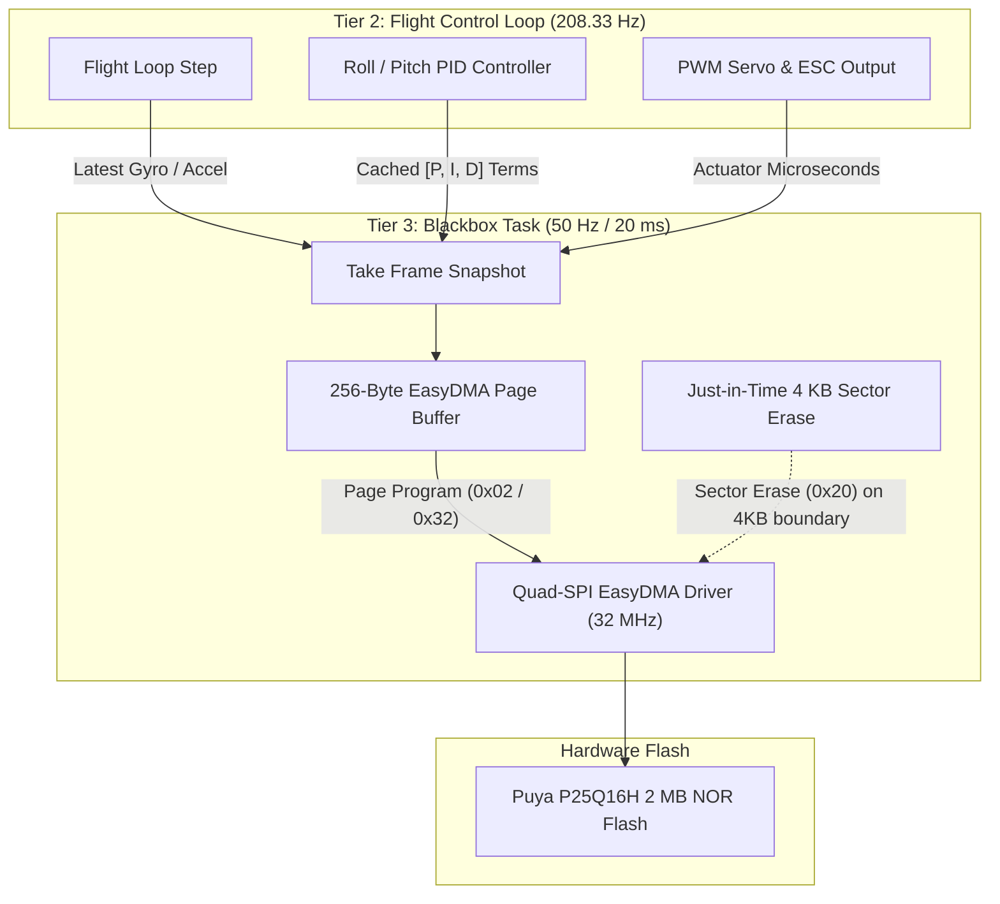

# Onboard QSPI Blackbox Flight Data Recorder

WingFC-rs records high-rate flight telemetry autonomously to the Seeed Studio XIAO nRF52840 Sense onboard 2 MB NOR flash. This document covers the hardware architecture, the 32-byte binary frame format, offloading logs over USB CDC-ACM or DebugMate SWD, and reviewing logs in Betaflight Blackbox Explorer.

---

## 1. Architecture Overview

Blackbox logging runs as part of the Tier 3 background task suite at 50 Hz (20 ms logging period). Recording begins automatically when the aircraft is armed and halts when disarmed.



### Hardware Specifications

* **Memory Device:** Puya P25Q16H (2 MB / 16 Mbit NOR Flash).
* **Interface:** Dedicated Nordic nRF52840 QSPI hardware peripheral in Quad-I/O mode.
* **Bus Speed:** 32 MHz SCK clock with 32-bit hardware EasyDMA transfers.
* **Pin Allocation:**
  * `P0.20`: Chip Select (`CS#`)
  * `P0.21`: Serial Clock (`CLK`)
  * `P0.22`: Data I/O 0 (`IO0` / `SI`)
  * `P0.23`: Data I/O 1 (`IO1` / `SO`)
  * `P0.24`: Data I/O 2 (`IO2` / `WP#`)
  * `P0.25`: Data I/O 3 (`IO3` / `HOLD#`)
* **Logging Rate:** 50 Hz (1 frame every 20 ms).
* **Data Bandwidth:** 1.60 KB/s during armed flight (32 bytes per frame * 50 Hz).
* **Flash Storage Capacity:** 2,080,768 usable bytes across 508 sectors, providing approximately 21.6 minutes of continuous recording before storage wraps.

---

## 2. Memory Organization & Safety

The 2 MB flash address space is partitioned into a metadata header and consecutive log sectors:

| Address Range | Size | Allocation | Purpose |
| :--- | :--- | :--- | :--- |
| `0x000000` .. `0x000FFF` | 4,096 B | Sector 0 (Header) | Magic `0x57464342` ("WFCB"), write pointer, total session count |
| `0x004000` .. `0x1FEFFF` | 2,080,768 B | Sectors 1 .. 508 | Sequential 32-byte flight frame log storage |
| `0x1FF000` .. `0x1FFFFF` | 4,096 B | Sector 509 | Boundary guard sector (write pointer resets to `0x004000`) |

### Write and Erase Safety Rules

1. **Armed Lockout for Erase Operations:**
   Flash erase commands (`BBL_ERASE` over USB or mailbox command over SWD) are locked out while the aircraft is armed. The flight controller rejects erase requests with `ERR:ARMED` to guarantee control loop determinism in flight.
2. **Just-in-Time Sector Erasing:**
   When logging into fresh sectors, the firmware erases the target 4 KB sector only when the write pointer crosses a 4096-byte boundary. Erase operations execute asynchronously in the background task without blocking the 208.33 Hz flight loop.
3. **Session Persistence:**
   The write pointer and session counter are committed to Sector 0. If power is removed unexpectedly, all previously logged sessions up to the last 256-byte page flush remain valid in flash.

---

## 3. Binary Frame Specification (Version 2)

Each frame occupies exactly 32 bytes with a trailing CRC-8 checksum:

```
Byte Offset:
 0      1      2      3      4..7            8..13            14..19
+------+------+------+------+---------------+----------------+----------------+
| MAGIC| VER  |STATUS| SEQ  |  TIME (ms)    | GYRO (3x i16)  | ACCEL (3x i16) |
| 0xBB | 0x02 | 1 B  | 1 B  | 4 B LE (u32)  | 6 B LE         | 6 B LE         |
+------+------+------+------+---------------+----------------+----------------+

 20..22          23..25          26..29               30      31
+---------------+---------------+--------------------+-------+--------+
| PITCH P,I,D   | ROLL P,I,D    | ACTUATORS PACKED   | RSVD  | CRC-8  |
| 3x i8 (scale) | 3x i8 (scale) | 4 B LE (3x 10-bit) | 0x00  | ITU/ATM|
+---------------+---------------+--------------------+-------+--------+
```

### Detailed Field Definitions

| Bytes | Type | Field | Scaling / Resolution | Description |
| :--- | :--- | :--- | :--- | :--- |
| **0** | `u8` | `magic` | Exact `0xBB` | Start of frame marker. |
| **1** | `u8` | `version` | Exact `0x02` | Frame schema version (v2 includes PID terms). |
| **2** | `u8` | `status_flags` | Bitfield | Bit 0: Armed (1 = armed, 0 = disarmed).<br>Bit 1: Failsafe (1 = active). |
| **3** | `u8` | `seq_lo` | Direct `0..255` | Low 8 bits of monotonic frame counter. |
| **4..7** | `u32` | `timestamp_ms` | 1 ms / LSB | Milliseconds elapsed since flight controller boot. |
| **8..13** | `[i16; 3]` | `gyro` | 0.001 rad/s / LSB | Angular rates in vehicle frame: Roll (X), Pitch (Y), Yaw (Z). Range: &plusmn;32.767 rad/s (&plusmn;1877 deg/s). |
| **14..19** | `[i16; 3]` | `accel` | 0.01 m/s&sup2; / LSB | Linear acceleration: X, Y, Z. Range: &plusmn;327.67 m/s&sup2; (&plusmn;33.4 G). |
| **20..22** | `[i8; 3]` | `pid_pitch` | 1 / 500.0 per LSB | Pitch controller terms: `[P, I, D]`. Range: &plusmn;0.254 mixer deflection. |
| **23..25** | `[i8; 3]` | `pid_roll` | 1 / 500.0 per LSB | Roll controller terms: `[P, I, D]`. Range: &plusmn;0.254 mixer deflection. |
| **26..29** | `u32` | `actuators` | 1 &mu;s / LSB | Packed 3x 10-bit pulse widths mapping [0..1000] to [1000..2000] &mu;s:<br>&bull; Bits 0..9: Servo 1 (Elevon Left)<br>&bull; Bits 10..19: Servo 2 (Elevon Right)<br>&bull; Bits 20..29: Throttle (Motor ESC)<br>&bull; Bits 30..31: Reserved |
| **30** | `u8` | `reserved` | 0x00 | Alignment byte. |
| **31** | `u8` | `crc8` | Polynomial `0x07` | CRC-8 ITU/ATM checksum computed across bytes 0..30. |

---

## 4. Offloading Logs (`scripts/blackbox.py`)

The companion Python script handles discovery, download, integrity checks, and simultaneous conversion into both Betaflight Blackbox (`.bbl`) and CSV (`.csv`) files.

### Connection Modes

The tool auto-detects the active transport:
1. **Native USB CDC-ACM:** When the XIAO USB-C port is plugged into your PC.
2. **XIAO DebugMate (SWD):** Direct memory transfers through `probe-rs` and the in-RAM `BBL_SWD_MAILBOX`. Useful on the bench or when USB serial is unavailable.

### Command Reference

```bash
# 1. Inspect flash usage, write pointer, and flight session count
python3 scripts/blackbox.py info

# Force SWD transport explicitly through DebugMate
python3 scripts/blackbox.py info --swd

# 2. Dump flash data and generate BOTH flight.bbl and flight.csv simultaneously
python3 scripts/blackbox.py dump flight

# Specify a custom base name (produces session_01.bbl and session_01.csv)
python3 scripts/blackbox.py dump session_01

# Also save the raw 32-byte binary stream (produces session_01.bin)
python3 scripts/blackbox.py dump session_01 --raw

# 3. Export an existing .bbl or raw .bin file to CSV format
python3 scripts/blackbox.py export-csv flight.bbl flight.csv

# 4. Erase recorded flash sectors before your next flight
python3 scripts/blackbox.py erase
```

---

## 5. Reviewing Logs in Betaflight Blackbox Explorer

The generated `.bbl` file conforms to the standard Betaflight Blackbox v2 container specification.

1. **Open the Explorer:**
   Navigate to the web application at [blackbox.betaflight.com](https://blackbox.betaflight.com/) in Chrome or Edge, or open the standalone desktop application.
2. **Load Log File:**
   Drag and drop `flight.bbl` directly into the browser window.
3. **Select Craft Mixer Model (Critical Step):**
   * Click the **Settings (Gear icon)** in the top right corner.
   * Under **Model / Craft Configuration**, switch the model type from default **Quad X** to **Airplane / Flying Wing**.
   * The 3D model visualization and control surface graphs will now match your elevons (`servo[0]`, `servo[1]`) and motor throttle (`motor[0]`).

### Telemetry Traces Mapped to Explorer Channels

| Blackbox Explorer Channel | WingFC-rs Source Telemetry | Scale / Unit |
| :--- | :--- | :--- |
| **`time`** | Monotonic loop time | Microseconds (&mu;s) |
| **`loopIteration`** | Log sequence counter | Monotonic index |
| **`axisP[0]` / `axisP[1]`** | Roll and Pitch Proportional term | Scaled mixer effort (0 to 1000) |
| **`axisI[0]` / `axisI[1]`** | Roll and Pitch Integral accumulator | Scaled mixer effort (0 to 1000) |
| **`axisD[0]` / `axisD[1]`** | Roll and Pitch Derivative term | Scaled mixer effort (0 to 1000) |
| **`rcCommand[0..3]`** | Commanded Roll, Pitch, Yaw, Throttle | Centered command deflection |
| **`gyroADC[0..2]`** | Angular rate on Roll, Pitch, Yaw | Degrees per second (deg/s) |
| **`accSmooth[0..2]`** | Accelerometer readings | Milli-G (1000 = 1.0 G) |
| **`servo[0]` / `servo[1]`** | Left and Right elevon pulse widths | Microseconds (1000 to 2000 &mu;s) |
| **`motor[0]`** | ESC throttle pulse width | Microseconds (1000 to 2000 &mu;s) |
| **`debug[0]` / `debug[1]`** | Estimated Roll and Pitch angles | Tenths of a degree (0.1 deg/LSB) |
| **`debug[3]`** | System status bitfield | Bit 0: Armed, Bit 1: Failsafe |

---

## 6. Practical Tuning Guide Using Blackbox Logs

### 1. Isolating D-Term Noise and Frame Vibration
* In the Explorer, enable the graph traces for `gyroADC[0]` (Roll rate) and `axisD[0]` (Roll D-term).
* If `axisD` displays dense, high-frequency oscillations while the craft is in steady level flight, mechanical motor vibration is leaking into the derivative term.
* Increase gyro low-pass filtering in [`wingfc.yaml`](../wingfc.yaml) under `flight.gyro_lpf_cutoff_hz` (default 42 Hz) or decrease the D gain for that axis.

### 2. Tuning P and D Response on Sharp Stick Deflections
* Locate a rapid roll or pitch command step in the timeline.
* Compare `rcCommand` against `gyroADC`:
  * **Overshoot / Ringing:** If the gyro rate overshoots the setpoint and oscillates 2 to 3 times before settling, increase the axis D-term or decrease P.
  * **Sluggish Tracking:** If the gyro rate lags behind the commanded rate with no overshoot, increase P.

### 3. Checking Integral Windup on Launch
* During ground run-up and hand launch, check `axisI[0]` and `axisI[1]`.
* If the I-term hits saturation before the aircraft achieves airspeed, verify that the anti-windup accumulator limits in [`crates/wingfc-core/src/pid.rs`](../crates/wingfc-core/src/pid.rs) prevent runaway deflection while on the ground.
