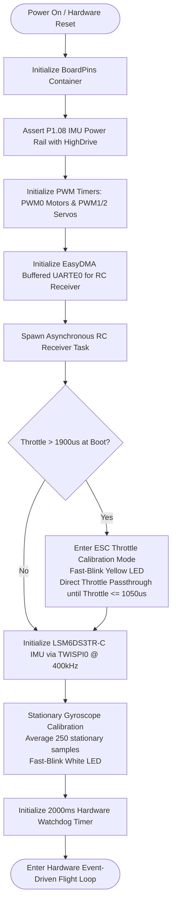
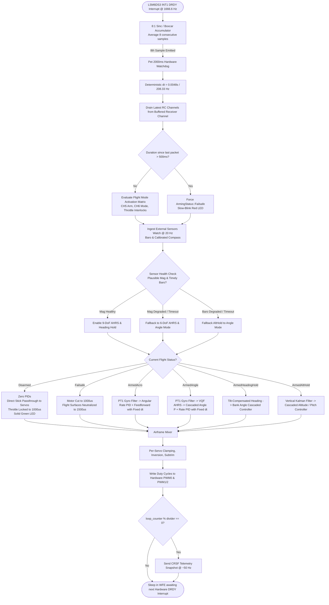
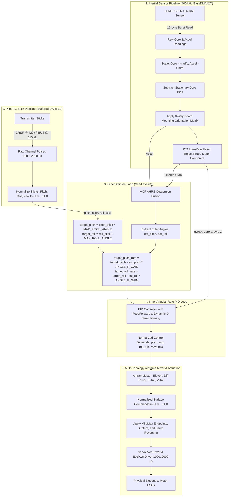
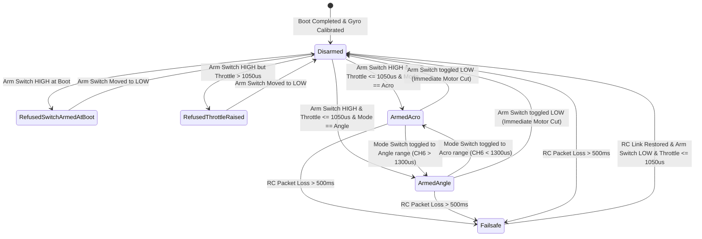
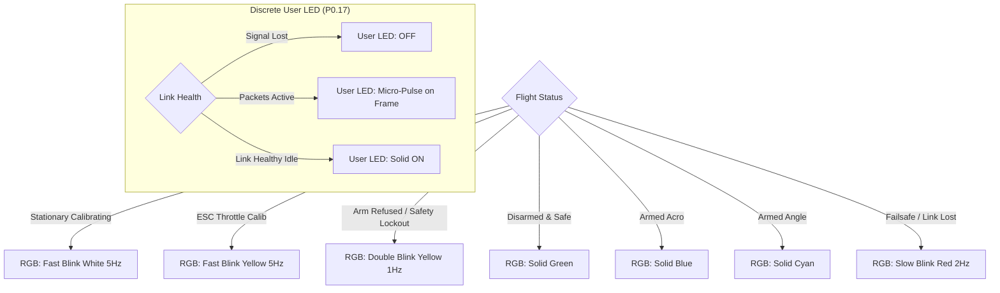

# WingFC-rs System Architecture & Control Flowcharts

This document compiles the complete architectural and dataflow flowcharts for `wingfc-rs`, serving as a visual reference for system boot, real-time sensor processing, cascaded attitude stabilization, arming safety logic, and hardware actuation.

---

## 1. System Boot & Initialization Sequence

---

## 2. Multi-Rate Decoupled Flight Loop (1666.6 Hz IMU -> 208.33 Hz Loop)

---

## 3. Signal Dataflow: Where IMU Meets Stick Input (Armed Angle Mode)

---

## 4. Arming Safety State Machine & Flight Mode Matrix

---

## 5. Visual Telemetry LED Status Logic

