# Pin Configuration & Hardware Allocation Specification

This document provides the hardware architecture, physical pin mapping, electrical requirements, and peripheral multiplexing specifications for the `wingfc-rs` flight controller firmware running on Nordic Semiconductor nRF52840 hardware.

Only **physical castellated edge pads** are used across both supported form factors (Standard XIAO Sense and XIAO Sense Plus) to ensure direct surface-mount compatibility with carrier PCBs. Underside test pads and solder balls are strictly avoided.

> [!TIP]
> Complete KiCad 4-layer PCB design files, schematics, and mechanical 3D models for the official carrier board are maintained in the dedicated hardware repository:
> 👉 [**ferrox-rc/wingfc-hardware**](https://github.com/ferrox-rc/wingfc-hardware)

---

## 1. High-Level Hardware Architecture

The firmware decouples physical pins from algorithm drivers via the [`BoardPins`](../crates/wingfc-firmware/src/pins.rs) container. All peripheral mappings conform to hardware-level DMA constraints (EasyDMA) on the nRF52840 SoC.

```mermaid
graph TD
    subgraph "Nordic nRF52840 Hardware Core"
        PWM0["PWM0 Peripheral (ESCs 1 & 2)"]
        PWM1["PWM1 Peripheral (Primary Servos 1..4)"]
        PWM2["PWM2 Peripheral (Secondary Servos 5..8 - Sense Plus)"]
        TWISPI0["TWISPI0 Peripheral (Internal IMU Fast-Mode 400kHz I2C)"]
        TWISPI1["TWISPI1 Peripheral (External I2C: Compass & Baro)"]
        UARTE0["UARTE0 Peripheral (EasyDMA RC Serial Link)"]
        UARTE1["UARTE1 Peripheral (EasyDMA GPS Serial Link - Sense Plus)"]
        SAADC["SAADC Peripheral (Battery Voltage Sensing - Sense Plus)"]
    end

    subgraph "Firmware BoardPins Abstraction"
        BP["BoardPins::from_peripherals(p)"]
    end

    subgraph Actuators
        M1["Motor 1: ESC (D3 / P0.29)"]
        M2["Motor 2: ESC (D8 / P1.13)"]
        S1["Servo 1: Left Elevon / Aileron (D0 / P0.02)"]
        S2["Servo 2: Right Elevon / Elevator (D1 / P0.03)"]
        S3["Servo 3: Rudder / V-Tail (D2 / P0.28)"]
        S4["Servo 4: Right Aileron / Flap (D9 / P1.14)"]
        S5["Servo 5: Aux / Gear / Pan (D10 / P1.15)"]
        SExt["Servos 6..8: Expansion (D11..D13 - Sense Plus)"]
    end

    subgraph "External Sensors & Comms"
        EXT_I2C["External I2C Bus (D4 SDA / D5 SCL: Compass / Baro)"]
        RC["RC Receiver / Telemetry (D6 TX / D7 RX)"]
        GPS["GPS Navigation Module (D14 RX / D15 TX - Sense Plus)"]
        BAT["Battery Voltage Sensing (D16 AIN7 - Sense Plus)"]
    end

    PWM0 --> M1
    PWM0 --> M2
    PWM1 --> S1
    PWM1 --> S2
    PWM1 --> S3
    PWM1 --> S4
    PWM2 -.-> S5
    PWM2 -.-> SExt
    TWISPI1 --> EXT_I2C
    UARTE0 --> RC
    UARTE1 -.-> GPS
    SAADC -.-> BAT
```



---

## 2. Standard Target: Seeed Studio XIAO nRF52840 Sense

The standard XIAO nRF52840 Sense provides an ultra-compact (21 &times; 17.5 mm) footprint with 14 castellated edge pads, an integrated 6-DoF IMU, and telemetry LEDs.

### Castellated Pin Diagram (DIP-14 Compatible Edge Pads)

```
                            Standard XIAO Sense Castellated Pads
                         +--------------------------------------+
   Servo 1      (PWM1) --| Pin 1:  D0 (P0.02)     Pin 14: 5V    |-- 5V VBUS Input / Output
   Servo 2      (PWM1) --| Pin 2:  D1 (P0.03)     Pin 13: GND   |-- System Ground
   Servo 3      (PWM1) --| Pin 3:  D2 (P0.28)     Pin 12: 3V3   |-- 3.3V Output
   Motor 1 ESC  (PWM0) --| Pin 4:  D3 (P0.29)     Pin 11: D10   |-- Servo 5 (P1.15 / PWM2)
   Ext I2C SDA (TWISPI1)-| Pin 5:  D4 (P0.04)     Pin 10: D9    |-- Servo 4 (P1.14 / PWM1)
   Ext I2C SCL (TWISPI1)-| Pin 6:  D5 (P0.05)     Pin 9:  D8    |-- Motor 2 ESC (P1.13 / PWM0)
   RC Telemetry TX(DMA) -| Pin 7:  D6 (P1.11)     Pin 8:  D7    |-- RC Receiver RX (P1.12 / DMA)
                         +--------------------------------------+
```

### Castellated Edge Pad Allocation Table

| Pad | Silkscreen | Chip Pin | Subsystem | Function / Role | Peripheral & Channel | Electrical Specification |
| :--- | :--- | :--- | :--- | :--- | :--- | :--- |
| **Pin 1** | `D0` | `P0.02` | Actuator | Servo 1 (Left Elevon / Aileron) | `PWM1` (Ch 0) | 50..400 Hz PWM, 1000..2000 &mu;s |
| **Pin 2** | `D1` | `P0.03` | Actuator | Servo 2 (Right Elevon / Elevator) | `PWM1` (Ch 1) | 50..400 Hz PWM, 1000..2000 &mu;s |
| **Pin 3** | `D2` | `P0.28` | Actuator | Servo 3 (Rudder / Left V-Tail / Aux) | `PWM1` (Ch 2) | 50..400 Hz PWM, 1000..2000 &mu;s |
| **Pin 4** | `D3` | `P0.29` | Actuator | Motor 1 ESC Signal | `PWM0` (Ch 0) | 50..400 Hz PWM or DShot frame |
| **Pin 5** | `D4` | `P0.04` | External Bus | External I2C SDA (Compass & Barometer) | `TWISPI1` SDA | 400 kHz Fast-Mode I2C Bus |
| **Pin 6** | `D5` | `P0.05` | External Bus | External I2C SCL (Compass & Barometer) | `TWISPI1` SCL | 400 kHz Fast-Mode I2C Bus |
| **Pin 7** | `D6` | `P1.11` | Telemetry | RC Serial Telemetry Output | `UARTE0` TX | CRSF (420 kBaud) or iBus |
| **Pin 8** | `D7` | `P1.12` | Receiver | RC Receiver Serial Input | `UARTE0` RX | CRSF (420 kBaud) or iBus |
| **Pin 9** | `D8` | `P1.13` | Actuator | Motor 2 ESC Signal (Diff Thrust) | `PWM0` (Ch 1) | 50..400 Hz PWM or DShot frame |
| **Pin 10**| `D9` | `P1.14` | Actuator | Servo 4 (Right Aileron / Flap / Aux) | `PWM1` (Ch 3) | 50..400 Hz PWM, 1000..2000 &mu;s |
| **Pin 11**| `D10`| `P1.15` | Actuator | Servo 5 (Aux / Gear / Pan) | `PWM2` (Ch 0) | 50..400 Hz PWM, 1000..2000 &mu;s |
| **Pin 12**| `3V3`| &mdash; | Power | 3.3V Regulated Output | Onboard LDO | 3.3V DC Rail (Max 200 mA) |
| **Pin 13**| `GND`| &mdash; | Power | System Ground | Ground | 0V System Reference |
| **Pin 14**| `5V` | &mdash; | Power | VBUS 5V Power Input / Output | USB / Battery Rail | 4.5V &ndash; 5.5V Rail |

---

## 3. Expansion Target: Seeed Studio XIAO nRF52840 Sense Plus

The **XIAO Sense Plus** expands the physical castellated edge perimeter to 23 pads (D0..D19, 5V, GND, 3V3), enabling full autonomous GPS navigation, 8 servo linkages, and battery ADC telemetry without utilizing underside test pads.

### Castellated Pad Allocation Table (23 Pads Total)

| Pad Silkscreen | Chip Pin | Subsystem | Function / Role | Peripheral & Channel | Electrical Specification |
| :--- | :--- | :--- | :--- | :--- | :--- |
| **`D0`** | `P0.02` | Actuator | Servo 1 (Left Elevon / Aileron) | `PWM1` (Ch 0) | 50..400 Hz PWM |
| **`D1`** | `P0.03` | Actuator | Servo 2 (Right Elevon / Elevator) | `PWM1` (Ch 1) | 50..400 Hz PWM |
| **`D2`** | `P0.28` | Actuator | Servo 3 (Rudder / V-Tail) | `PWM1` (Ch 2) | 50..400 Hz PWM |
| **`D3`** | `P0.29` | Actuator | Motor 1 ESC Signal | `PWM0` (Ch 0) | 50..400 Hz PWM / DShot |
| **`D4`** | `P0.04` | External Bus | External I2C SDA (Compass & Baro) | `TWISPI1` SDA | 400 kHz Fast-Mode I2C |
| **`D5`** | `P0.05` | External Bus | External I2C SCL (Compass & Baro) | `TWISPI1` SCL | 400 kHz Fast-Mode I2C |
| **`D6`** | `P1.11` | Telemetry | RC Serial Telemetry Output | `UARTE0` TX | CRSF / iBUS |
| **`D7`** | `P1.12` | Receiver | RC Receiver Serial RX | `UARTE0` RX | CRSF / iBUS |
| **`D8`** | `P1.13` | Actuator | Motor 2 ESC Signal (Diff Thrust) | `PWM0` (Ch 1) | 50..400 Hz PWM / DShot |
| **`D9`** | `P1.14` | Actuator | Servo 4 (Right Aileron / Flap) | `PWM1` (Ch 3) | 50..400 Hz PWM |
| **`D10`**| `P1.15` | Actuator | Servo 5 (Aux / Gear / Pan) | `PWM2` (Ch 0) | 50..400 Hz PWM |
| **`D11`**| `P0.15` | Actuator | Servo 6 (Aux / Flap / Pan) | `PWM2` (Ch 1) | 50..400 Hz PWM |
| **`D12`**| `P0.19` | Actuator | Servo 7 (Aux / Tilt / Arm) | `PWM2` (Ch 2) | 50..400 Hz PWM |
| **`D13`**| `P1.01` | Actuator | Servo 8 (Aux / Payload Drop) | `PWM2` (Ch 3) | 50..400 Hz PWM |
| **`D14`**| `P0.09` | Navigation | GPS Receiver Serial RX | `UARTE1` RX | EasyDMA NMEA / UBX (from GPS TX) |
| **`D15`**| `P0.10` | Navigation | GPS Receiver Serial TX | `UARTE1` TX | EasyDMA NMEA / UBX (to GPS RX) |
| **`D16`**| `P0.31` | Telemetry | Battery Voltage ADC Input | `SAADC` AIN7 | Analog voltage divider (0..3.3V) |
| **`D17`**| `P1.03` | Expansion | SPI Clock / Spare GPIO | Spare | Digital I/O |
| **`D18`**| `P1.05` | Expansion | SPI MISO / Spare GPIO | Spare | Digital I/O |
| **`D19`**| `P1.07` | Expansion | SPI MOSI / Spare GPIO | Spare | Digital I/O |
| **`3V3`**| &mdash; | Power | 3.3V Regulated Output | Power Rail | 3.3V DC Rail |
| **`GND`**| &mdash; | Power | System Ground | Ground | 0V System Reference |
| **`5V`** | &mdash; | Power | VBUS 5V Power Input / Output | Power Rail | 5V Rail |

---

## 4. Internal On-Board Peripherals (Shared Across Both Boards)

| Function | nRF52840 Pin | Hardware Block | Description & Configuration |
| :--- | :--- | :--- | :--- |
| **IMU Power Rail** | `P1.08` | GPIO Output | Internal high-side power switch for LSM6DS3TR (Standard Drive, Active HIGH) |
| **IMU I2C SDA** | `P0.07` | `TWISPI0` | Internal I2C data line (400 kHz Fast-Mode, strictly isolated from external I2C) |
| **IMU I2C SCL** | `P0.27` | `TWISPI0` | Internal I2C clock line (400 kHz Fast-Mode, strictly isolated from external I2C) |
| **IMU Interrupt 1 (INT1)** | `P0.11` | GPIOTE Input | Hardware Gyro/Accel Data-Ready (DRDY) interrupt triggering DMA burst read |
| **Telemetry LED Red** | `P0.26` | GPIO Output | Visual Telemetry indicator (Active-LOW, sink current) |
| **Telemetry LED Green** | `P0.30` | GPIO Output | Visual Telemetry indicator (Active-LOW, sink current) |
| **Telemetry LED Blue** | `P0.06` | GPIO Output | Visual Telemetry indicator (Active-LOW, sink current) |
| **Telemetry User LED** | `P0.17` | GPIO Output | Discrete status / GPS lock indicator (Active-LOW, sink current) |
| **Reset / Boot Button** | `P0.18` | Hardware Reset | Triggers hardware system reset or bootloader entry |
| **Battery Read Enable** | `P0.14` | GPIO Output | Active-LOW voltage divider enable |

---

## 5. Dual-LED Visual Telemetry System

The flight controller employs a two-tier visual feedback system: the primary **3-color RGB LED** displays vehicle arming and safety states, while the discrete **User LED (`P0.17`)** provides link quality and navigation lock telemetry.

### Primary RGB LED Matrix

| LED Color | Visual Pattern | Frequency | Arming / Flight State | Meaning & Required Action |
| :--- | :--- | :--- | :--- | :--- |
| **White** | Fast Flash | 5 Hz (100ms ON / 100ms OFF) | `VisualStatus::calibrating()` | **Gyro Calibration:** Measuring zero-rate bias at boot (250 samples). Keep aircraft motionless. |
| **Yellow** | Fast Flash | 5 Hz (100ms ON / 100ms OFF) | `VisualStatus::esc_calibrating()` | **ESC Calibration Mode:** Throttle high at boot. Pass-through active to calibrate ESC endpoints. |
| **Yellow** | Double Blink | 2 pulses every 1.0 s | `ArmingStatus::Refused*` | **Arming Refused:** Throttle > zero threshold or switch armed at boot. Lower throttle and cycle switch. |
| **Red** | Slow Blink | 2 Hz (250ms ON / 250ms OFF) | `ArmingStatus::Failsafe` | **Failsafe / Link Lost:** No RC frames received within timeout. Check receiver binding and wiring. |
| **Green** | Solid ON | Constant | `ArmingStatus::Disarmed` | **Disarmed & Ready:** Valid RC link active, gyro calibrated, motors safe. Aircraft ready to arm. |
| **Blue** | Solid ON | Constant | `ArmingStatus::ArmedAcro` | **Armed (Acro / Rate Mode):** Flight loop live, motors active, angular rate stabilization active. |
| **Cyan** | Solid ON | Constant | `ArmingStatus::ArmedAngle` | **Armed (Angle / Self-Leveling):** Flight loop live, motors active, attitude self-leveling active. |

### Secondary User LED (`P0.17`)

* **Non-GPS Builds (`#[cfg(not(feature = "gps"))]`):**
  * **OFF:** RC receiver disconnected or link in failsafe.
  * **Solid ON:** RC link healthy and receiving valid frames.
  * **Micro-Toggle Pulse:** Heartbeat blip confirming real-time packet streaming.
* **GPS Builds (`#[cfg(feature = "gps")]`):**
  * **1 Hz Gentle Pulse (500ms ON / 500ms OFF):** Searching for satellites / Fix < 3D / < 4 satellites.
  * **2 Hz Double-Flash Cadence:** 3D fix acquired, acquiring precision (4&ndash;7 satellites).
  * **Solid ON:** Full navigation lock (&ge; 8 satellites) and home point latched.
