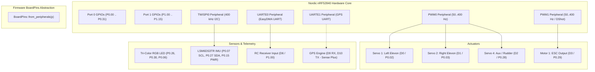

# Pin Configuration & Hardware Allocation Specification

This document provides the hardware architecture, physical pin mapping, electrical requirements, and peripheral multiplexing specifications for the `wingfc-rs` flight controller firmware running on Nordic Semiconductor nRF52840 hardware.

---

## 1. High-Level Hardware Architecture

The firmware decouples physical pins from algorithm drivers via the [`BoardPins`](file:///home/bryansouza/Repos/wingfc-rs/crates/wingfc-firmware/src/pins.rs) abstraction. All peripheral mappings conform to hardware-level DMA constraints (EasyDMA) on the nRF52840 SoC.



---

## 2. Standard Target: Seeed Studio XIAO nRF52840 Sense

The standard XIAO nRF52840 Sense provides an ultra-compact (21 &times; 17.5 mm) footprint with 14 castellated/through-hole pins (7 on each header row) and integrated 6-DoF IMU.

### Physical Layout & Header Mapping

```
                            Seeed XIAO nRF52840 Sense
                         +-----------------------------+
   Elevon Left  (PWM0) --| D0 (P0.02)         (P0.06)  |-- Blue LED (Active-LOW)
   Elevon Right (PWM0) --| D1 (P0.03)         (P0.30)  |-- Green LED (Active-LOW)
   Aux Servo    (PWM0) --| D2 (P0.28)         (P0.26)  |-- Red LED (Active-LOW)
   ESC Motor 1  (PWM1) --| D3 (P0.29)         (P0.07)  |-- IMU SCL (Internal TWISPI0)
   Available / Ext SDA --| D4 (P0.04)         (P0.27)  |-- IMU SDA (Internal TWISPI0)
   Available / Ext SCL --| D5 (P0.05)         (P0.15)  |-- IMU Power Rail Enable
   RC RX (EasyDMA UARTE)-| D6 (P1.00)         (3.3V)   |-- 3.3V Regulated Output (200mA)
   Available / GPIO    --| D7 (P0.11)         (GND)    |-- Common Ground
                         | 3.3V               (5V)     |-- 5V VBUS Input
                         | GND                (RST)    |-- Hardware Reset
                         +-----------------------------+
```

### External Header Pin Assignments (DIP-14)

| Header Pin | Silkscreen | nRF52840 Pin | Subsystem | Function / Role | Peripheral & Channel | Electrical Spec |
| :--- | :--- | :--- | :--- | :--- | :--- | :--- |
| Pin 1 | `D0` | `P0.02` | Actuator | Left Elevon Servo | `PWM0` (Channel 0) | 50..400 Hz PWM, 1000..2000 &mu;s, 3.3V CMOS |
| Pin 2 | `D1` | `P0.03` | Actuator | Right Elevon Servo | `PWM0` (Channel 1) | 50..400 Hz PWM, 1000..2000 &mu;s, 3.3V CMOS |
| Pin 3 | `D2` | `P0.28` | Actuator | Auxiliary Servo / Rudder | `PWM0` (Channel 2) | 50..400 Hz PWM, 1000..2000 &mu;s, 3.3V CMOS |
| Pin 4 | `D3` | `P0.29` | Actuator | Motor 1 ESC Signal | `PWM1` (Channel 0) | 50..400 Hz PWM (or DShot digital frame) |
| Pin 5 | `D4` | `P0.04` | Expansion | General GPIO / Ext I2C SDA | Reserved (`TWISPI1`) | 3.3V LVCMOS, Pull-up required for I2C |
| Pin 6 | `D5` | `P0.05` | Expansion | General GPIO / Ext I2C SCL | Reserved (`TWISPI1`) | 3.3V LVCMOS, Pull-up required for I2C |
| Pin 7 | `D6` | `P1.00` | Receiver | RC Receiver Serial RX | `UARTE0` RX | CRSF (420 kBaud) or iBus (115.2 kBaud) |
| Pin 8 | `D7` | `P0.11` | Expansion | General GPIO / NFC / Beeper| Reserved (GPIO) | 3.3V LVCMOS |
| Pin 9 | `3V3` | &mdash; | Power | 3.3V DC Power Rail | Onboard LDO Output | Max 200 mA output |
| Pin 10 | `GND` | &mdash; | Power | Common Ground Reference | System Ground | 0V reference |
| Pin 11 | `5V` | &mdash; | Power | USB / VBUS Power Input | USB VBUS | 4.5V &ndash; 5.5V input from USB |
| Pin 12 | `RST` | `P0.18` | System | Reset Pin | Hardware RESET | Active-LOW Reset |

### Internal On-Board Peripherals (Non-Exposed Pins)

| Function | nRF52840 Pin | Hardware Block | Description & Configuration |
| :--- | :--- | :--- | :--- |
| **IMU Power Rail** | `P0.15` | GPIO Output | Internal high-side power switch for LSM6DS3TR (Drive HIGH to power IMU) |
| **IMU I2C SCL** | `P0.07` | `TWISPI0` | Internal I2C clock line (400 kHz Fast-Mode) |
| **IMU I2C SDA** | `P0.27` | `TWISPI0` | Internal I2C data line (400 kHz Fast-Mode) |
| **Telemetry LED Red** | `P0.26` | GPIO Output | Visual Telemetry indicator (Active-LOW, sink current) |
| **Telemetry LED Green** | `P0.30` | GPIO Output | Visual Telemetry indicator (Active-LOW, sink current) |
| **Telemetry LED Blue** | `P0.06` | GPIO Output | Visual Telemetry indicator (Active-LOW, sink current) |
| **Reset / Boot Button** | `P0.18` | Hardware Reset | Triggers hardware system reset or bootloader entry |

---

## 3. Peripheral Resource Allocation & Conflict Matrix

The Nordic nRF52840 contains several shared hardware register blocks where multiple logical peripherals map to the same physical hardware instance (e.g., `UARTE0` shares hardware with `UART0`, and `TWISPI0` shares hardware with `TWIM0`/`SPIM0`).

| Peripheral Block | Allocated Subsystem | Used Pins | Potential Conflict / Notes |
| :--- | :--- | :--- | :--- |
| **`PWM0`** | Servos (Ch 0, 1, 2) | `P0.02`, `P0.03`, `P0.28` | Conflict free. Configurable 50..400 Hz frame rate. |
| **`PWM1`** | ESC Motor Output | `P0.29` | Conflict free. Configurable 50..400 Hz PWM or DShot. |
| **`TWISPI0`** | Internal LSM6DS3TR IMU | `P0.07`, `P0.27` | Dedicated to internal I2C bus. Cannot be used for SPI. |
| **`UARTE0`** | RC Receiver (DMA) | `P1.00` | RX-only EasyDMA serial engine. Pin TX is unrouted. |
| **`TWISPI1`** | Optional External Sensors | `P0.04`, `P0.05` | Free for external compass/barometer I2C on standard XIAO. |
| **`UARTE1`** | GPS Navigation (NMEA) | `P0.09`, `P0.10` | Broken out on `D9` (RX) and `D10` (TX) on XIAO Sense Plus (Requires `nfc-pins-as-gpio`). |

---

## 4. GPS Navigation Expansion & The "Sense Plus" Requirement

### Architectural Pin Limitation on Standard XIAO
The standard Seeed Studio XIAO nRF52840 exposes only 8 usable GPIO header pins (`D0`&ndash;`D7`). Under the baseline flight controller configuration:
- 3 pins are allocated for Servos (`D0`, `D1`, `D2`).
- 1 pin is allocated for ESC Motor Control (`D3`).
- 2 pins are reserved for external I2C Barometer & Compass (`D4`, `D5`).
- 1 pin is allocated for Serial RC Receiver (`D6` / `P1.00`).
- 1 pin is available for GPIO / Beeper (`D7`).

### Why GPS Demands Seeed Studio XIAO nRF52840 Sense Plus:
1. **Secondary Asynchronous Serial Engine (`UARTE1`):** The nRF52840 requires a second hardware UART engine to communicate with GPS modules (NMEA / UBX @ 115,200 baud). `UARTE0` is already consumed by the primary RC link (`CRSF` @ 420 kBaud or `iBus` @ 115.2 kBaud).
2. **Additional Header Breakouts:** The **Seeed Studio XIAO nRF52840 Sense Plus** variant exposes additional header pins (`D8`, `D9`, `D10`, `D11`) and underside surface-mount solder pads, providing physical breakout lines for:
   - `UARTE1_RX` (GPS serial data from module).
   - `UARTE1_TX` (GPS configuration commands to module).
   - Battery voltage ADC divider (`AIN`).
   - Dedicated Piezo buzzer transistor drive.

```
                           Sense Plus Expansion Map (GPS Navigation)
                         +---------------------------------------+
   Standard 14-Pin XIAO -| D0 .. D7 Header (Servos, ESC, RC, I2C)|
   Expanded Pins (Plus) -| D8  (P0.12) - Battery Voltage ADC AIN |
                         | D9  (P0.09) - GPS UARTE1 RX (NMEA)    |
                         | D10 (P0.10) - GPS UARTE1 TX (NMEA)    |
                         | D11 (P0.16) - Piezo Alarm Buzzer Out  |
                         +---------------------------------------+
```

> [!NOTE]
> **nRF52840 NFC Pin Reconfiguration:** Physical pins `P0.09` and `P0.10` are routed to the nRF52840 internal NFC antenna module by default. To repurpose them as standard high-speed digital GPIOs for `UARTE1`, `wingfc-firmware` enables the `nfc-pins-as-gpio` feature in `embassy-nrf`, disabling the internal NFC resonance circuitry at hardware boot.

---

## 5. Electrical Wiring & Power Isolation Guidelines

1. **3.3V LVCMOS Logic:** All nRF52840 GPIO pins operate strictly at 3.3V logic levels. Never connect 5V RC receivers or 5V sensors directly to input pins without an appropriate level shifter or voltage divider.
2. **Servo Power Isolation (5V BEC):** Servos must **NEVER** draw power from the XIAO's 3.3V onboard LDO (pin 9). Servos draw inductive current spikes exceeding 1.5A during aggressive maneuvers, which will collapse the 3.3V rail and reset the MCU in flight. Power all servo center pins directly from a dedicated 5V switching BEC, with a common ground shared with the XIAO.
3. **ESC Throttle Ground Loop:** Always connect both the ESC signal ground and signal wire to the flight controller to prevent ground bounce errors on high-speed 400Hz PWM or DShot signals.
