# Pin Configuration & Hardware Allocation Specification

This document provides the hardware architecture, physical pin mapping, electrical requirements, and peripheral multiplexing specifications for the `wingfc-rs` flight controller firmware running on Nordic Semiconductor nRF52840 hardware.

---

## 1. High-Level Hardware Architecture

The firmware decouples physical pins from algorithm drivers via the [`BoardPins`](file:///home/bryansouza/Repos/wingfc-rs/crates/wingfc-firmware/src/pins.rs) container. All peripheral mappings conform to hardware-level DMA constraints (EasyDMA) on the nRF52840 SoC.

```mermaid
graph TD
    subgraph "Nordic nRF52840 Hardware Core"
        P0["Port 0 GPIOs (P0.00 .. P0.31)"]
        P1["Port 1 GPIOs (P1.00 .. P1.15)"]
        PWM0["PWM0 Peripheral (ESCs 1 & 2)"]
        PWM1["PWM1 Peripheral (Primary Servos 1..4)"]
        PWM2["PWM2 Peripheral (Secondary Servos 5..8 - Plus)"]
        TWISPI0["TWISPI0 Peripheral (400 kHz I2C)"]
        UARTE0["UARTE0 Peripheral (EasyDMA RC UART)"]
        UARTE1["UARTE1 Peripheral (GPS Navigation UART)"]
    end

    subgraph "Firmware BoardPins Abstraction"
        BP["BoardPins::from_peripherals(p)"]
    end

    subgraph Actuators
        M1["Motor 1: ESC Output (D3 / P0.29)"]
        M2["Motor 2: ESC Output (D4 / P0.04)"]
        S1["Servo 1: Left Elevon / Aileron (D0 / P0.02)"]
        S2["Servo 2: Right Elevon / Elevator (D1 / P0.03)"]
        S3["Servo 3: Rudder / Aux (D2 / P0.28)"]
        S4["Servo 4: Flap / Aux (D5 / P0.05)"]
        SExt["Servos 5..8: Expansion (D8..D11 - Plus)"]
    end

    subgraph Sensors & Telemetry
        RGB["Tri-Color RGB LED (P0.26, P0.30, P0.06)"]
        ULED["User LED (P0.17)"]
        IMU["LSM6DS3TR IMU (P0.07 SDA, P0.27 SCL, P1.08 PWR)"]
        RC["RC Receiver Input (D7 / P1.12)"]
        GPS["GPS Engine (D14 RX, D15 TX - Plus)"]
    end

    PWM0 --> M1
    PWM0 --> M2
    PWM1 --> S1
    PWM1 --> S2
    PWM1 --> S3
    PWM1 --> S4
    PWM2 -.-> SExt
    TWISPI0 --> IMU
    UARTE0 --> RC
    UARTE1 -.-> GPS
```



---

## 2. Standard Target: Seeed Studio XIAO nRF52840 Sense

The standard XIAO nRF52840 Sense provides an ultra-compact (21 &times; 17.5 mm) footprint with 14 castellated/through-hole pins (7 on each header row), an integrated 6-DoF IMU, and dual telemetry LEDs.

### Physical Layout & Header Mapping

```
                            Seeed XIAO nRF52840 Sense
                         +-----------------------------+
   Servo 1      (PWM1) --| D0 (P0.02)         (P0.06)  |-- Blue LED (Active-LOW)
   Servo 2      (PWM1) --| D1 (P0.03)         (P0.30)  |-- Green LED (Active-LOW)
   Servo 3      (PWM1) --| D2 (P0.28)         (P0.26)  |-- Red LED (Active-LOW)
   ESC Motor 1  (PWM0) --| D3 (P0.29)         (P0.17)  |-- User/Charge LED (Active-LOW)
   ESC Motor 2  (PWM0) --| D4 (P0.04)         (P0.07)  |-- IMU SDA (Internal TWISPI0)
   Servo 4      (PWM1) --| D5 (P0.05)         (P0.27)  |-- IMU SCL (Internal TWISPI0)
   RC Telemetry TX (DMA)-| D6 (P1.11)         (P1.08)  |-- IMU Power Rail Enable
   RC Receiver RX (DMA) -| D7 (P1.12)         (3.3V)   |-- 3.3V Regulated Output (200mA)
                         | 3.3V               (GND)    |-- Common Ground
                         | GND                (5V)     |-- 5V VBUS Input
                         | 5V                 (RST)    |-- Hardware Reset
                         +-----------------------------+
```

### External Header Pin Assignments (DIP-14)

| Header Pin | Silkscreen | nRF52840 Pin | Subsystem | Function / Role | Peripheral & Channel | Electrical Spec |
| :--- | :--- | :--- | :--- | :--- | :--- | :--- |
| Pin 1 | `D0` | `P0.02` | Actuator | Servo 1 (Left Elevon / Aileron) | `PWM1` (Ch 0) | 50..400 Hz PWM, 1000..2000 &mu;s, Standard Drive |
| Pin 2 | `D1` | `P0.03` | Actuator | Servo 2 (Right Elevon / Elevator) | `PWM1` (Ch 1) | 50..400 Hz PWM, 1000..2000 &mu;s, Standard Drive |
| Pin 3 | `D2` | `P0.28` | Actuator | Servo 3 (Rudder / Left V-Tail / Aux) | `PWM1` (Ch 2) | 50..400 Hz PWM, 1000..2000 &mu;s, Standard Drive |
| Pin 4 | `D3` | `P0.29` | Actuator | Motor 1 ESC Signal | `PWM0` (Ch 0) | 50..400 Hz PWM or DShot frame, Standard Drive |
| Pin 5 | `D4` | `P0.04` | Actuator | Motor 2 ESC Signal (Diff Thrust) | `PWM0` (Ch 1) | 50..400 Hz PWM or DShot frame, Standard Drive |
| Pin 6 | `D5` | `P0.05` | Actuator | Servo 4 (Secondary Aileron / Flap) | `PWM1` (Ch 3) | 50..400 Hz PWM, 1000..2000 &mu;s, Standard Drive |
| Pin 7 | `D6` | `P1.11` | Telemetry | CRSF Telemetry Output | `UARTE0` TX | 420 kBaud serial output to receiver (CRSF) |
| Pin 8 | `D7` | `P1.12` | Receiver | RC Receiver Serial RX | `UARTE0` RX | CRSF (420 kBaud) or iBus (115.2 kBaud) |
| Pin 9 | `3V3` | &mdash; | Power | 3.3V DC Power Rail | Onboard LDO Output | Max 200 mA output |
| Pin 10 | `GND` | &mdash; | Power | Common Ground Reference | System Ground | 0V reference |
| Pin 11 | `5V` | &mdash; | Power | USB / VBUS Power Input | USB VBUS | 4.5V &ndash; 5.5V input from USB |
| Pin 12 | `RST` | `P0.18` | System | Reset Pin | Hardware RESET | Active-LOW Reset |

### Internal On-Board Peripherals

| Function | nRF52840 Pin | Hardware Block | Description & Configuration |
| :--- | :--- | :--- | :--- |
| **IMU Power Rail** | `P1.08` | GPIO Output | Internal high-side power switch for LSM6DS3TR (Standard Drive, Active HIGH) |
| **IMU I2C SDA** | `P0.07` | `TWISPI0` | Internal I2C data line (400 kHz Fast-Mode) |
| **IMU I2C SCL** | `P0.27` | `TWISPI0` | Internal I2C clock line (400 kHz Fast-Mode) |
| **IMU Interrupt 1 (INT1)** | `P0.11` | GPIOTE Input | Hardware Gyro/Accel Data-Ready (DRDY) interrupt triggering DMA burst read |
| **Telemetry LED Red** | `P0.26` | GPIO Output | Visual Telemetry indicator (Active-LOW, sink current) |
| **Telemetry LED Green** | `P0.30` | GPIO Output | Visual Telemetry indicator (Active-LOW, sink current) |
| **Telemetry LED Blue** | `P0.06` | GPIO Output | Visual Telemetry indicator (Active-LOW, sink current) |
| **Telemetry User LED** | `P0.17` | GPIO Output | Discrete status / GPS lock indicator (Active-LOW, sink current) |
| **Reset / Boot Button** | `P0.18` | Hardware Reset | Triggers hardware system reset or bootloader entry |

---

## 3. Dual-LED Visual Telemetry System

The flight controller employs a two-tier visual feedback system: the primary **3-color RGB LED** displays vehicle arming and safety states, while the discrete **User LED (`P0.17`)** provides link quality and navigation lock telemetry.

### Primary RGB LED Matrix

| LED Color | Visual Pattern | Frequency | Arming / Flight State | Meaning & Required Action |
| :--- | :--- | :--- | :--- | :--- |
| **White** | Fast Flash | 5 Hz (100ms ON / 100ms OFF) | `VisualStatus::calibrating()` | **Gyro Calibration:** Measuring zero-rate bias at boot (250 samples). Keep aircraft motionless. |
| **Yellow** | Fast Flash | 5 Hz (100ms ON / 100ms OFF) | `VisualStatus::esc_calibrating()` | **ESC Calibration Mode:** Throttle high at boot. Pass-through active to calibrate ESC endpoints. |
| **Yellow** | Double Blink | 2 pulses every 1.0 s | `ArmingStatus::Refused*` | **Arming Refused:** Throttle > zero threshold or switch armed at boot. Lower throttle and cycle switch. |
| **Red** | Slow Blink | 2 Hz (250ms ON / 250ms OFF) | `ArmingStatus::Failsafe` | **Failsafe / Link Lost:** No RC frames received within timeout. Check receiver binding and wiring. |
| **Green** | Solid ON | Constant | `ArmingStatus::Disarmed` | **Disarmed & Ready:** Valid RC link active, gyro calibrated, motors safe. Aircraft ready to arm. |
| **Blue** | Solid ON | Constant | `ArmingStatus::ArmedAcro` | **Armed (Acro / Rate Mode):** Flight loop live, motors active, angular rate stabilization active. |
| **Cyan** | Solid ON | Constant | `ArmingStatus::ArmedAngle` | **Armed (Angle / Self-Leveling):** Flight loop live, motors active, attitude self-leveling active. |

### Secondary User LED (`P0.17`)

* **Non-GPS Builds (`#[cfg(not(feature = "gps"))]`):**
  * **OFF:** RC receiver disconnected or link in failsafe.
  * **Solid ON:** RC link healthy and receiving valid frames.
  * **Micro-Toggle Pulse:** Heartbeat blip confirming real-time packet streaming.
* **GPS Builds (`#[cfg(feature = "gps")]`):**
  * **1 Hz Gentle Pulse (500ms ON / 500ms OFF):** Searching for satellites / Fix < 3D / < 4 satellites.
  * **2 Hz Double-Flash Cadence:** 3D fix acquired, acquiring precision (4&ndash;7 satellites).
  * **Solid ON:** Full navigation lock (&ge; 8 satellites) and home point latched.

---

## 4. Expansion Target: Seeed Studio XIAO nRF52840 Sense Plus

Autonomous GPS navigation and high-channel actuators utilize the **Sense Plus** form factor:

### Peripheral & Channel Expansion Map

| Subsystem | Peripheral | Physical Pin | Header Silkscreen | Role / Description |
| :--- | :--- | :--- | :--- | :--- |
| **GPS Serial RX** | `UARTE1` RX | `P0.09` | `D14` (NFC1) | NMEA / UBX GPS Receiver Data Input (115,200 baud) |
| **GPS Serial TX** | `UARTE1` TX | `P0.10` | `D15` (NFC2) | NMEA / UBX GPS Configuration Commands (115,200 baud) |
| **Servo 5** | `PWM2` Ch 0 | `P1.13` | `D8` | Auxiliary Servo 5 (50..400 Hz) |
| **Servo 6** | `PWM2` Ch 1 | `P1.14` | `D9` | Auxiliary Servo 6 (50..400 Hz) |
| **Servo 7** | `PWM2` Ch 2 | `P1.15` | `D10` | Auxiliary Servo 7 (50..400 Hz) |
| **Servo 8** | `PWM2` Ch 3 | `P0.15` | `D11` | Auxiliary Servo 8 (50..400 Hz) |
| **Battery ADC** | `SAADC` AIN7 | `P0.31` | `D16` | Main Flight Battery Voltage Divider |

> [!NOTE]
> `P0.09` and `P0.10` are configured as standard high-speed digital GPIOs at boot via `embassy-nrf`'s `nfc-pins-as-gpio` feature, bypassing the internal NFC resonance circuit.

---

## 5. Electrical Wiring & Power Isolation Guidelines

> [!CAUTION]
> ### ⚠️ Critical Electrical Isolation Warnings
> 1. **3.3V LVCMOS Logic:** All nRF52840 GPIO pins operate strictly at 3.3V logic levels. Never connect 5V RC receivers or 5V sensors directly to input pins without an appropriate level shifter or voltage divider.
> 2. **Servo Power Isolation (5V BEC):** Servos must **NEVER** draw power from the XIAO's 3.3V onboard LDO (Pin 9). Servos draw inductive current spikes exceeding 1.5A during aggressive maneuvers, which will collapse the 3.3V rail and cause an immediate in-flight MCU brownout reset. Power all servo center pins directly from a dedicated 5V switching BEC with a common ground shared with the XIAO.
> 3. **ESC Ground Reference:** Always connect both the ESC signal ground and signal wire to the flight controller to prevent ground bounce errors on high-speed 400Hz PWM or DShot signals.
