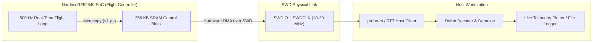
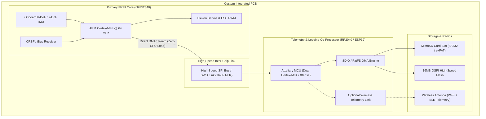

# High-Speed Telemetry, RTT, and Blackbox Logging Architecture

This document details the real-time telemetry and logging architecture for `wingfc-rs`, explaining how **SEGGER Real-Time Transfer (RTT)** and **Serial Wire Debug (SWD)** are utilized on the bench today, and how dedicated co-processor hardware and SD card storage will be integrated into the upcoming custom PCB.

---

## 1. Real-Time Transfer (RTT) & SWD on the Bench

### What is SEGGER RTT?
SEGGER Real-Time Transfer (RTT) is an ultra-low-overhead bidirectional communication protocol that operates directly through the ARM Cortex-M **Serial Wire Debug (SWD)** pins (`SWDIO`, `SWDCLK`). 

Unlike traditional UART serial logging or USB CDC-ACM virtual COM ports:
* **Zero Extra Pins:** RTT utilizes the existing 2-wire SWD debug interface. No GPIO or hardware UART engines are consumed.
* **Zero Loop Jitter (<1 &mu;s execution):** The Cortex-M4F CPU simply performs an `O(1)` memory copy into a ring buffer allocated in SRAM. The CPU does **not** wait for shift registers, baud clock divisors, or USB bus packet acknowledgments.
* **Asynchronous Memory Access by Debug Probe:** The host debug probe (e.g., J-Link, ST-Link, or CMSIS-DAP via `probe-rs`) reads and drains the ring buffer memory addresses directly over SWD while the 500Hz flight loop runs at full speed uninterrupted.



### Bench Setup Workflow with `probe-rs`
During bench testing, motor vibration testing, and sensor calibration:

1. **Connect Debug Probe:** Connect your SWD probe (CMSIS-DAP, J-Link, or Raspberry Pi Debug Probe) to the XIAO's underside `SWDIO`, `SWDCLK`, `3V3`, and `GND` pads.
2. **Launch Live RTT Stream:**
   ```bash
   probe-rs run --chip nRF52840_xxAA target/thumbv7em-none-eabihf/release/wingfc-firmware
   ```
3. **Deferred Formatting (`defmt`):**
   `wingfc-rs` uses `defmt` with `defmt-rtt`. Strings are interned at compile time: only 1-to-2 byte token IDs and raw binary values are transmitted over SWD. The host `probe-rs` utility decodes the stream using the local `.elf` symbol table, providing high-bandwidth logging with minimal binary footprint.

---

## 2. Multi-Channel RTT Protocol Specification

The RTT control block supports up to 16 independent bidirectional channels. In `wingfc-rs`, RTT is structured into three dedicated channels:

| Channel | Direction | Name | Buffer Size | Format | Purpose |
| :--- | :--- | :--- | :--- | :--- | :--- |
| **0** | Target &rarr; Host | `defmt` | 1024 B | Defmt Tokenized Binary | System status, arming alerts, and boot diagnostics |
| **1** | Target &rarr; Host | `blackbox` | 2048 B | Packed Binary Struct | 500Hz full-rate state snapshots for PID & vibration analysis |
| **2** | Host &rarr; Target | `tuning_cli`| 256 B | Compact ASCII / Bytecode | Live PID and filter tuning commands from the bench |

### Blackbox Packed Binary Frame (Channel 1)
Every 2ms flight loop cycle (500 Hz), a compact 28-byte binary frame is written into RTT Channel 1:

```rust
#[repr(C, packed)]
pub struct RttBlackboxFrame {
    pub timestamp_us: u32,    // 4 bytes: Loop monotonic timestamp
    pub gyro_raw: [i16; 3],    // 6 bytes: Gyro X, Y, Z (0.1 deg/s resolution)
    pub accel_raw: [i16; 3],   // 6 bytes: Accel X, Y, Z (0.01 m/s^2 resolution)
    pub rc_setpoint: [i16; 3], // 6 bytes: Commanded Roll, Pitch, Throttle
    pub servo_out: [i16; 2],   // 4 bytes: Elevon 1 & 2 microsecond outputs
    pub state_flags: u16,      // 2 bytes: Arming state, flight mode, failsafe flag
} // Total: 28 bytes per 2ms cycle = 14.0 KB/s bandwidth
```

At 500 Hz, this binary frame generates **14.0 KB/s** of stream data. Because the SWD link sustains 800 KB/s to 2.5 MB/s, logging at full flight-loop speed consumes less than **2% of available link bandwidth**.

---

## 3. Hardware Limitations of the Bare XIAO Module

While RTT is ideal for bench testing, **in-flight Blackbox logging requires persistent local storage.**

The bare Seeed Studio XIAO nRF52840 Sense module does not have the hardware required for autonomous in-flight Blackbox recording:
1. **No High-Speed Non-Volatile Flash:** The XIAO Sense lacks an external SPI/QSPI NOR flash chip. Logging into internal MCU flash is unfeasible because flash page write/erase operations stall CPU execution for tens of milliseconds, which would breach the 2ms hard real-time flight loop deadline and crash the aircraft.
2. **No MicroSD Card Slot:** High-rate flight data logging (14 KB/s to 50 KB/s) requires multi-megabyte storage capacity. A standard 10-minute flight generates approximately 8.4 MB of raw telemetry data.
3. **GPIO Exhaustion:** Operating an SD card in SDIO (4-bit) or SPI (4-wire) mode requires 4 to 6 GPIO pins. The standard XIAO exposes only 8 external GPIOs in total, all of which are consumed by Servos, ESC, RC Input, and external I2C.

---

## 4. Custom PCB Architecture: Dedicated Co-Processor & SD Card Subsystem

To provide seamless, in-flight Blackbox logging and expanded telemetry without degrading the primary flight controller's real-time deterministic performance, the upcoming custom hardware layout will incorporate a **dedicated secondary co-processor**:



### Architecture Advantages:
1. **Zero Real-Time Penalty on the Flight Controller:**
   SD card write operations routinely encounter unpredictable latency spikes (up to 100-250ms when an SD card internal controller performs wear-leveling or block allocation). Offloading file system operations (FatFS) to a companion co-processor completely insulates the primary flight loop from SD card latency spikes.
2. **Dedicated SD Card Storage:**
   The co-processor buffers incoming stream frames in RAM and flushes them to the MicroSD card using 4-bit high-speed SDIO DMA. A standard 32GB MicroSD card can store hundreds of flight hours.
3. **Blackbox Log Format Compatibility:**
   The co-processor writes flight logs in standard **Betaflight Blackbox (`.bbl`)** or **CSV** formats, enabling instant drag-and-drop analysis in the open-source **Betaflight Blackbox Explorer** for:
   * Gyro noise FFT spectral analysis and notch filter tuning.
   * Elevon PID step-response optimization.
   * Airspeed and barometric altitude safety audits.
4. **Wireless Ground Station Bridge:**
   If an ESP32 or wireless-capable co-processor is chosen, it can simultaneously serve as a high-speed Wi-Fi/Bluetooth bridge, transmitting live telemetry to a ground station tablet or laptop while writing the primary log to the SD card.

---

## 5. QSPI Onboard Blackbox & Betaflight Blackbox Explorer Workflow

On the Seeed Studio XIAO nRF52840 Sense, `wingfc-rs` natively logs armed flight sessions to the onboard **2 MB Puya P25Q16H QSPI NOR Flash** at 50 Hz. Each 32-byte frame records gyro rates, accelerations, servo/motor PWM outputs, and individual PID controller terms (`axisP`, `axisI`, `axisD` for roll and pitch).

### Offloading Blackbox Logs
Connect your computer either via the USB-C port on the XIAO or via the **Seeed Studio XIAO DebugMate (SWD)** and run:

```bash
# 1. Inspect flash capacity and recorded sessions (auto-detects USB or DebugMate SWD)
python3 scripts/blackbox.py info

# 2. Dump and automatically convert to Betaflight Blackbox v2 format (.bbl)
python3 scripts/blackbox.py dump flight.bbl

# Optional: To dump via XIAO DebugMate SWD explicitly
python3 scripts/blackbox.py dump flight.bbl --swd

# Optional: To export raw telemetry to CSV for spreadsheet / Python Pandas analysis
python3 scripts/blackbox.py export-csv flight.bbl flight.csv

# 3. Erase logged sessions to free flash capacity for your next flight
python3 scripts/blackbox.py erase
```

---

### Viewing Logs in Betaflight Blackbox Explorer

The generated `flight.bbl` log is 100% compatible with the official open-source **[Betaflight Blackbox Explorer](https://blackbox.betaflight.com/)** (or the standalone desktop application).

> [!IMPORTANT]
> **Switching from Default Quad X to Airplane / Flying Wing Mixer**
> By default, the Betaflight Blackbox Explorer visualizes crafts as a multirotor (`Quad X`). Because `wingfc-rs` flies sub-250g flying wings and airplanes, you should switch the 3D visualizer model:
> 1. Open [Betaflight Blackbox Explorer](https://blackbox.betaflight.com/) in Google Chrome or Microsoft Edge.
> 2. Drag and drop your downloaded `flight.bbl` file into the window.
> 3. Click the **Gear icon (Settings)** in the upper right corner.
> 4. In **Model / Craft Configuration**, switch the model type or craft mixer from **Quad X** to **Airplane / Flying Wing** (or custom elevon mixer).
> 5. The 3D orientation preview and control surface graphs will now reflect your elevons / ailerons (`servo[0]`, `servo[1]`) and motor throttle (`motor[0]`).

---

### PID Analysis & Flight Tuning Traces

The generated `.bbl` container includes live PID and FeedForward terms generated by `wingfc-core`:

* **`axisP[0]` / `axisP[1]`**: Proportional control effort on Roll and Pitch.
* **`axisI[0]` / `axisI[1]`**: Integrated error response and anti-windup trim on Roll and Pitch.
* **`axisD[0]` / `axisD[1]`**: Derivative damping effort on Roll and Pitch.
* **`rcCommand[0..3]`**: Commanded stick deflections and throttle.
* **`gyroADC[0..2]`**: Angular rates in degrees per second (&deg;/s).
* **`accSmooth[0..2]`**: Linear accelerations in milli-G.

Use the graph trace visibility checkboxes in Blackbox Explorer to isolate `axisP` and `axisD` against `gyroADC` during sharp stick maneuvers to verify damping without high-frequency D-term oscillation.
