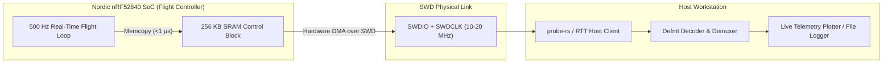
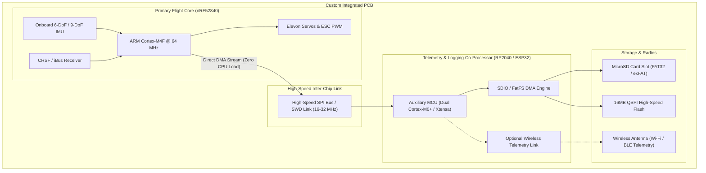

# High-Speed Telemetry, RTT, and Blackbox Logging Architecture

This document details the real-time telemetry and logging architecture for `wingfc-rs`, explaining how **SEGGER Real-Time Transfer (RTT)** and **Serial Wire Debug (SWD)** are utilized on the bench today, and how dedicated co-processor hardware and SD card storage will be integrated into the upcoming custom PCB.

---

## 1. Real-Time Transfer (RTT) & SWD on the Bench

### What is SEGGER RTT?
SEGGER Real-Time Transfer (RTT) is an ultra-low-overhead bidirectional communication protocol that operates directly through the ARM Cortex-M **Serial Wire Debug (SWD)** pins (`SWDIO`, `SWDCLK`). 

Unlike traditional UART serial logging or USB CDC-ACM virtual COM ports:
* **Zero Extra Pins:** RTT utilizes the existing 2-wire SWD debug interface. No GPIO or hardware UART engines are consumed.
* **Zero Loop Jitter (<1 &mu;s execution):** The Cortex-M4F CPU simply performs an `O(1)` memory copy into a ring buffer allocated in SRAM. The CPU does **not** wait for shift registers, baud clock divisors, or USB bus packet acknowledgments.
* **Asynchronous Memory Access by Debug Probe:** The host debug probe (e.g., J-Link, ST-Link, or CMSIS-DAP via `probe-rs`) reads and drains the ring buffer memory addresses directly over SWD while the 500Hz flight loop runs at full speed uninterrupted.



### Bench Setup Workflow with `probe-rs`
During bench testing, motor vibration testing, and sensor calibration:

1. **Connect Debug Probe:** Connect your SWD probe (CMSIS-DAP, J-Link, or Raspberry Pi Debug Probe) to the XIAO's underside `SWDIO`, `SWDCLK`, `3V3`, and `GND` pads.
2. **Launch Live RTT Stream:**
   ```bash
   probe-rs run --chip nRF52840_xxAA target/thumbv7em-none-eabihf/release/wingfc-firmware
   ```
3. **Deferred Formatting (`defmt`):**
   `wingfc-rs` uses `defmt` with `defmt-rtt`. Strings are interned at compile time: only 1-to-2 byte token IDs and raw binary values are transmitted over SWD. The host `probe-rs` utility decodes the stream using the local `.elf` symbol table, providing high-bandwidth logging with minimal binary footprint.

---

## 2. Multi-Channel RTT Protocol Specification

The RTT control block supports up to 16 independent bidirectional channels. In `wingfc-rs`, RTT is structured into three dedicated channels:

| Channel | Direction | Name | Buffer Size | Format | Purpose |
| :--- | :--- | :--- | :--- | :--- | :--- |
| **0** | Target &rarr; Host | `defmt` | 1024 B | Defmt Tokenized Binary | System status, arming alerts, and boot diagnostics |
| **1** | Target &rarr; Host | `blackbox` | 2048 B | Packed Binary Struct | 500Hz full-rate state snapshots for PID & vibration analysis |
| **2** | Host &rarr; Target | `tuning_cli`| 256 B | Compact ASCII / Bytecode | Live PID and filter tuning commands from the bench |

### Blackbox Packed Binary Frame (Channel 1)
Every 2ms flight loop cycle (500 Hz), a compact 28-byte binary frame is written into RTT Channel 1:

```rust
#[repr(C, packed)]
pub struct RttBlackboxFrame {
    pub timestamp_us: u32,    // 4 bytes: Loop monotonic timestamp
    pub gyro_raw: [i16; 3],    // 6 bytes: Gyro X, Y, Z (0.1 deg/s resolution)
    pub accel_raw: [i16; 3],   // 6 bytes: Accel X, Y, Z (0.01 m/s^2 resolution)
    pub rc_setpoint: [i16; 3], // 6 bytes: Commanded Roll, Pitch, Throttle
    pub servo_out: [i16; 2],   // 4 bytes: Elevon 1 & 2 microsecond outputs
    pub state_flags: u16,      // 2 bytes: Arming state, flight mode, failsafe flag
} // Total: 28 bytes per 2ms cycle = 14.0 KB/s bandwidth
```

At 500 Hz, this binary frame generates **14.0 KB/s** of stream data. Because the SWD link sustains 800 KB/s to 2.5 MB/s, logging at full flight-loop speed consumes less than **2% of available link bandwidth**.

---

## 3. Persistent Storage: Onboard QSPI Flash vs. MicroSD

While RTT is ideal for real-time bench monitoring over SWD, in-flight flight logging requires non-volatile storage:

1. **Onboard 2 MB QSPI NOR Flash (Current XIAO Implementation):**
   WingFC-rs records armed flight sessions directly to the Seeed Studio XIAO's onboard Puya P25Q16H 2 MB NOR flash at 50 Hz. This provides 21.6 minutes of autonomous flight recording per cycle without consuming external GPIOs. Complete frame format specifications, offload instructions, and Betaflight Blackbox Explorer workflows are documented in [Onboard QSPI Blackbox Flight Data Recorder](BLACKBOX.md).
2. **Upcoming Custom PCB Architecture (Co-Processor & SD Card):**
   To support multi-hour continuous recording without SD card write latency spikes impacting the primary flight loop, future custom carrier hardware offloads FatFS and SDIO operations to a dedicated auxiliary MCU.

---

## 4. Custom PCB Architecture: Dedicated Co-Processor & SD Card Subsystem

To provide hours of continuous high-rate logging without degrading the primary flight controller's real-time deterministic performance, the upcoming custom hardware layout incorporates an auxiliary co-processor:



### Architecture Advantages:
1. **Zero Real-Time Penalty on the Flight Controller:**
   SD card write operations routinely encounter latency spikes (100 to 250 ms when an SD card internal controller performs wear-leveling or block allocation). Offloading file system operations to a companion co-processor completely insulates the primary flight loop from SD latency spikes.
2. **Dedicated Multi-Hour Storage:**
   The co-processor buffers incoming stream frames in RAM and flushes them to the MicroSD card using 4-bit high-speed SDIO DMA. A standard 32 GB MicroSD card stores hundreds of flight hours.
3. **Wireless Ground Station Bridge:**
   An ESP32 or wireless-capable co-processor can simultaneously serve as a high-speed Wi-Fi or Bluetooth bridge, transmitting live telemetry to a ground station tablet or laptop while writing the primary log to the SD card.

---

## 5. Dedicated Documentation Reference

For practical flight logging guides, frame byte definitions, and offloading instructions, see:

* [Onboard QSPI Blackbox Flight Data Recorder](BLACKBOX.md): Details the 32-byte binary frame format, USB/SWD dump procedures via `scripts/blackbox.py`, and Betaflight Blackbox Explorer airplane mixer setup.
* [Pin Configuration & Hardware Allocation Specification](PINOUT.md): Details pin assignments and electrical characteristics for the nRF52840 QSPI bus on `P0.20` through `P0.25`.

